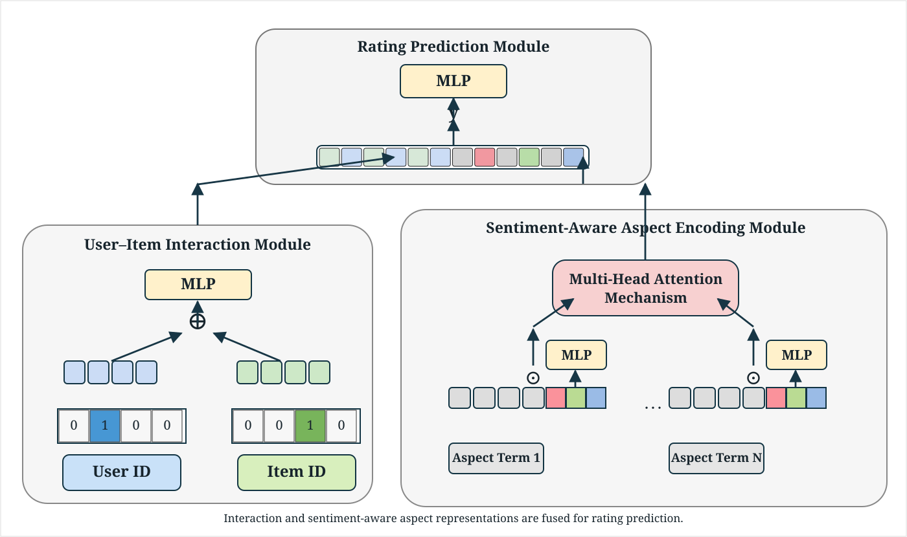

<div align="center">

# DAAR

**Leveraging Large Language Models for Domain-Agnostic Aspect-Aware Recommendation**

Official implementation of **Domain-Agnostic Aspect-Aware Recommendation (DAAR)** for review-based rating prediction.

</div>

## Overview

DAAR uses zero-shot LLM-based aspect term extraction (ATE) and aspect-level sentiment information to model fine-grained preferences without predefined aspect categories.

### Overall Framework (Figure 2)


### Recommender System Architecture (Figure 3)



## Repository Structure

```text
DAAR/
├── preprocessing/         # Aspect extraction, postprocessing, embeddings, sentiment
├── model/daar.py          # DAAR model architecture
├── data/README.md         # Dataset format
├── config.yaml            # Training and model configuration
├── train.py               # Training and test-data export
├── evaluate.py            # Rating prediction evaluation
└── requirements.txt       # Python dependencies
```

## Setup

```bash
pip install -r requirements.txt
python -m spacy download en_core_web_sm
```

ATE requires access to `meta-llama/Llama-3.1-8B-Instruct` on Hugging Face. Set `HF_TOKEN` in your environment:

- Linux/macOS: `export HF_TOKEN=YOUR_TOKEN`
- Windows PowerShell: `$env:HF_TOKEN="YOUR_TOKEN"`

## Datasets

We evaluate DAAR on **Amazon Baby Products**, **Amazon Office Products**, and **Yelp restaurant reviews from Indiana**.

- [Amazon Reviews 2023](https://amazon-reviews-2023.github.io/)
- [Yelp Open Dataset](https://www.yelp.com/dataset)

Raw data are **not redistributed** in this repository. Each input record must contain a user ID, item ID, rating, and review text. See [data/README.md](data/README.md) for the expected fields. Prepare the Indiana restaurant subset for Yelp before running the pipeline.

The commands below use **Baby Products** as an example. For other datasets, change the file paths and column arguments as needed.

## Preprocessing

**1. Extract aspect terms** with LLaMA 3.1-8B-Instruct (4-bit NF4, greedy decoding, `max_new_tokens=100`).

```bash
python preprocessing/extract_aspects.py \
  --input data/Baby_Products.jsonl \
  --output data/Baby_Products_ate.json \
  --lines --drop-duplicates --remove-punctuation
```

The `--remove-punctuation` option replaces Unicode punctuation and symbols with spaces and normalizes whitespace. Extracted terms are subsequently matched against reviews without case sensitivity.

**2. Postprocess aspects** by removing terms absent from the review and non-noun single-word terms. Discard reviews with no valid aspects, apply 5-core filtering, and truncate aspect lists to the dataset's 75th-percentile length (`K_max`).

```bash
python preprocessing/postprocess_aspects.py \
  --input data/Baby_Products_ate.json \
  --output data/Baby_Products_postprocessed.json \
  --five-core --percentile 75
```

**3. Embed aspects** using `whaleloops/phrase-bert` (768 dimensions).

```bash
python preprocessing/embed_aspects.py \
  --input data/Baby_Products_postprocessed.json \
  --output data/Baby_Products_embeddings.json
```

**4. Predict aspect-level sentiment** using `yangheng/deberta-v3-base-absa-v1.1` (negative, neutral, positive probabilities).

```bash
python preprocessing/sentiment_analysis.py \
  --input data/Baby_Products_embeddings.json \
  --output data/Baby_Products_final.json
```

## Training and Evaluation

Update `config.yaml` to point to the final preprocessed dataset, then run:

```bash
python train.py --config config.yaml
python evaluate.py --test-data artifacts/test_data.npz --model checkpoints/daar.keras
```

Training uses a **7:1:2 train/validation/test split**, Adam optimization, and early stopping. The model combines user/item representations with sentiment-aware aspect representations using multi-head attention. Shorter aspect sequences are zero-padded and masked.

The evaluation script reports **MAE, MSE, and RMSE**; the paper's primary metrics are **MAE** and **RMSE**. The prediction input includes the corresponding review-derived features at evaluation time, consistent with the paper's review-available rating-prediction setting.

## Citation

Citation details will be added after publication.
