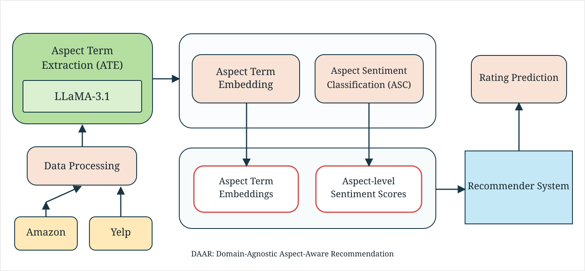

# DAAR

**Leveraging Large Language Models for Domain-Agnostic Aspect-Aware Recommendation**

Official implementation of **DAAR (Domain-Agnostic Aspect-Aware Recommendation)**, a review-based rating-prediction framework using LLM-extracted aspect terms and their sentiment information.

## Overview

DAAR extracts aspect terms from reviews using **LLaMA 3.1-8B-Instruct** and represents each term through **Phrase-BERT** embeddings and **DeBERTa** sentiment probabilities. A sentiment-aware attention module is combined with user–item interaction modeling to predict ratings.

<p align="center">
  
</p>

## Model Architecture

<p align="center">
  
</p>

The recommender system contains three modules: **user–item interaction**, **sentiment-aware aspect encoding**, and **rating prediction**. Implementation details are in [`model/`](model/README.md).

## Repository Structure

```text
DAAR/
├── assets/                # Overall framework figure
├── data/                  # Dataset format and preparation notes
├── model/                 # DAAR network and architecture diagram
├── preprocessing/         # ATE, postprocessing, embeddings, ABSA
├── config.yaml            # Model and training settings
├── train.py               # Train and save test artifacts
├── evaluate.py            # Evaluate saved model (MAE/MSE/RMSE)
├── requirements.txt       # Python dependencies
└── README.md
```

## Requirements

```bash
pip install -r requirements.txt
python -m spacy download en_core_web_sm
```

ATE requires Hugging Face access to `meta-llama/Llama-3.1-8B-Instruct`. Set `HF_TOKEN` before extraction (e.g., `export HF_TOKEN=YOUR_TOKEN` on Linux/macOS or `$env:HF_TOKEN="YOUR_TOKEN"` in PowerShell). A CUDA-enabled GPU is recommended for LLaMA inference.

## Datasets

Experiments use **Amazon Baby Products**, **Amazon Office Products**, and **Indiana restaurant reviews from Yelp**.

- [Amazon Reviews 2023](https://amazon-reviews-2023.github.io/)
- [Yelp Open Dataset](https://www.yelp.com/dataset)

Raw datasets are not included. Input records need user ID, item ID, rating, and review text. See [`data/README.md`](data/README.md) for column mappings and Yelp subset preparation.

## Preprocessing

The commands below use **Baby Products** as an example and assume the fields `user_id`, `asin`, `rating`, and `text`. Adapt column arguments and input paths for other datasets.

**1. Aspect term extraction (ATE)**

```bash
python preprocessing/extract_aspects.py --input data/Baby_Products.jsonl --output data/Baby_Products_ate.json --lines --drop-duplicates --remove-punctuation
```

Uses LLaMA 3.1-8B-Instruct with 4-bit NF4 quantization, greedy decoding, and `max_new_tokens=100`. The optional punctuation-cleaning flag also replaces Unicode symbols and normalizes whitespace.

**2. Aspect postprocessing**

```bash
python preprocessing/postprocess_aspects.py --input data/Baby_Products_ate.json --output data/Baby_Products_postprocessed.json --five-core --percentile 75
```

Removes out-of-review terms and non-noun single-word terms, drops reviews with no valid aspects, performs 5-core filtering, and truncates to the dataset-specific 75th-percentile aspect length (`K_max`).

**3. Aspect term embeddings**

```bash
python preprocessing/embed_aspects.py --input data/Baby_Products_postprocessed.json --output data/Baby_Products_embeddings.json
```

Uses `whaleloops/phrase-bert` to generate 768-dimensional aspect embeddings.

**4. Aspect sentiment classification (ASC)**

```bash
python preprocessing/sentiment_analysis.py --input data/Baby_Products_embeddings.json --output data/Baby_Products_final.json
```

Uses `yangheng/deberta-v3-base-absa-v1.1` to obtain negative, neutral, and positive probabilities for each aspect term.

Additional file-level descriptions are provided in [`preprocessing/README.md`](preprocessing/README.md).

## Training and Evaluation

Update the dataset path and columns in `config.yaml`, then run:

```bash
python train.py --config config.yaml
python evaluate.py --test-data artifacts/test_data.npz --model checkpoints/daar.keras
```

The default split is **7:1:2** (training/validation/test). The model uses Adam and early stopping; shorter aspect sequences are zero-padded and masked. Evaluation uses the corresponding review-derived features, consistent with the paper's *review-available rating prediction* setting.

## Experimental Results

Results reported in the manuscript (mean ± standard deviation over **five runs**; lower is better):

| Dataset | MAE ↓ | RMSE ↓ |
| --- | ---: | ---: |
| Baby Products | **0.408 ± 0.005** | **0.594 ± 0.003** |
| Office Products | **0.367 ± 0.006** | **0.540 ± 0.002** |
| Yelp (Indiana) | **0.521 ± 0.005** | **0.672 ± 0.003** |

The provided `train.py` performs one training run; the table reports the paper's five-run results, not the output of a single invocation.

## Citation

Publication details and the BibTeX entry will be added after publication.
